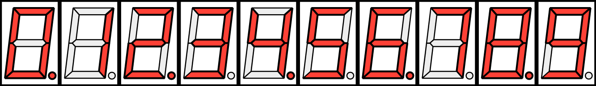
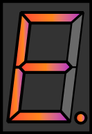
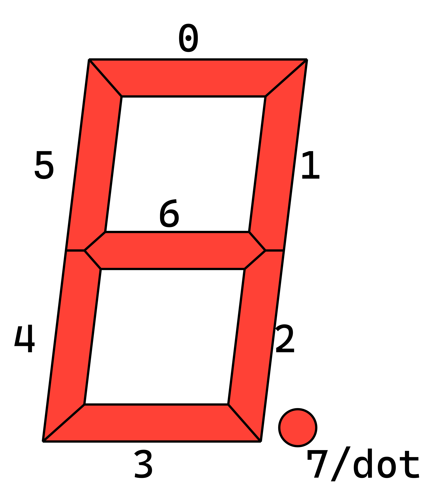

# segmented

Rendering seven-segment displays directly in your documents with vector polygons.

## Examples

<!-- img width is set so the table gets evenly spaced by GitHub's css -->
<table>
    <tr>
        <td>
            <a href="./examples/example_numbers.typ">
            
            </a>
        </td>
        <td>
            <a href="./examples/example_style.typ">
            
            </a>
        </td>
    </tr>
    <tr>
        <td>Displaying digits with <code> display-digit </code> </td>
        <td>You can style the display too!</td>
    </tr>
</table>

_Click on an example image to jump to the code._

## Usage

To use this package, simply add the following code to your document:

```typst
#import "@preview/segmented:0.1.0": *
```

**NOTE: This package is not yet listed on Typst Universe**. Instead, Clone the package into your local workspace:

```bash
git clone https://github.coom/TheOneTEM/typst-segmented
```

Then, import it locally:

```typst
#import "./typst-segmented/lib.typ": *
```

The package provides two functions: `seg-display` and `seg-display-digit`.

`seg-display` renders a 7-segment display where the status of each segment is individually specified. It expects the following arguments:

- `width` (length | relative): The width of the display. Aspect ratio is fixed at 478:697; this ratio is taken from a technical diagram for an actual segmented display.
- `stroke-box` (color | stroke): The stroke of the surrounding box.
- `fill-box`: The fill of the surrounding box.
- `fill-on`: The fill of the polygons when they are turned on.
- `stroke-on (stroke): The stroke of the polygons when they are turned on.
- `fill-off`: The fill of the polygons when they are turned off.
- `stroke-off` (stroke): The stroke of the polygons when they are turned off.
- `segments` (array): Boolean or integer (0..1) array that dictates which lights are turned on. One-hot, zero-indexed.
- The following diagram illustrates the segment positions:

<a href="./examples/example_pinout.typ">
    
</a>

_click on the image to jump to the source code_.

`seg-display-digit` renders a 7-segment display where a digit is displayed. It takes the same arguments as `seg-display`, but `segments` is replaced by the named parameter `digits`, which is a digit from 0 to 9.

It also takes an argument `dot`, which is whether or not to turn on the decimal point (DP).

## Roadmap

The following features are planned but not yet implemented:

- Some way to create presets for the displays.
- Different styles of segmented displays.
- Optional ability to style each segment for itself.
